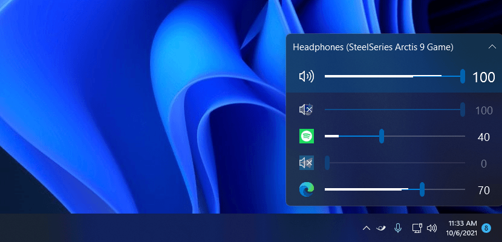

# EarTrumpet DragDrop

[](../../releases)
[](../../releases)
[](./LICENSE)
[](https://dotnet.microsoft.com/download/dotnet/8.0)
[](#系统要求)

EarTrumpet 的个人分支，在 [File-New-Project/EarTrumpet](https://github.com/File-New-Project/EarTrumpet) 2.3.0 的基础上，合入 [PR #1844](https://github.com/File-New-Project/EarTrumpet/pull/1844)（Windows 11 风格设置页与托盘菜单、应用识别加固、单元测试），并恢复了一个被上游砍掉的能力：**把应用卡片直接拖到播放设备上，切换它的输出设备**。



---

## 这个分支改了什么

| 方向 | 上游 2.3.0 | 本分支 |
| --- | --- | --- |
| 应用切换输出设备 | 右键菜单逐层选择 | **拖拽应用卡片到设备卡片**，一步完成 |
| 设置页 | 传统布局 | Win11 风格设置卡片（常规 / 音量 / 鼠标 / 外观 / 启动） |
| 托盘菜单 | 普通图标 | Fluent 图标，选中态与非选中态视觉统一 |
| 界面语言 | 简体中文缺部分文案 | 新增设置项全部补全中文 |
| 启动排障 | 无日志 | `%LOCALAPPDATA%\EarTrumpet\startup.log` 逐阶段记录 |
| 托盘图标 | GUID 失效即静默失败 | 注册失败自动更换 GUID 重试（自愈） |
| 运行时依赖 | `.NET 8` + WinRT 投影 | 去掉 WinRT/CsWinRT，改用 CsWin32 源生成，输出从 ~150 MB 降到 4.6 MB |
| 测试 | 无 | xUnit，本地化资源完整性 + 音量计算，23 项 |

完整变更见 [CHANGELOG.md](./CHANGELOG.md)。

## 功能

- **拖拽切换输出设备**：拖动任意应用卡片到目标设备卡片，松手即切。拖动时卡片跟随光标、目标设备高亮、来源卡片淡化
- **多通道音量可视化**：按声道显示峰值
- **独立音量混音器**：托盘小面板与完整窗口两种形态
- **默认播放设备管理**：切换、重命名、禁用
- **可配置热键**：唤出面板、调整音量
- **现代上下文菜单**：浅色 / 深色 / 强调色自适应
- **20+ 语言支持**，简体中文完整

## 下载与安装

1. 到 [Releases](../../releases) 下载最新的 `EarTrumpet-<version>-win-x64.zip`
2. 解压到任意目录（例如 `D:\Apps\EarTrumpet`）
3. 双击 `EarTrumpet.exe`

启动后常驻托盘，左键点托盘图标呼出面板。没有安装程序，删除目录即卸载（开机自启项需在设置里关掉）。

> **与 Microsoft Store 版冲突**：两者共用同一单实例互斥锁，不能同时运行。试用前请先在托盘右键退出 Store 版，否则本程序启动后看起来毫无反应。

## 系统要求

- Windows 10 1809（build 17763）及以上，或 Windows 11
- [.NET 8 桌面运行时](https://dotnet.microsoft.com/download/dotnet/8.0)（x64）
- 采用**框架依赖**发布，压缩包仅约 2 MB，因此必须安装运行时；不想装运行时可以按下面的命令自行编译自包含版本

## 从源码构建

需要 .NET 8 SDK，Windows 环境（WPF）。

```powershell
# 编译并发布到 dist/EarTrumpet-x64
dotnet publish EarTrumpet/EarTrumpet.csproj -c Release -p:Platform=x64 --self-contained false -o dist/EarTrumpet-x64
```

> `-p:Platform=x64` 不能省略。项目用 `$(Platform)` 生成 `X64` 编译常量（`Interop/Ntdll.cs` 里区分 x86/x64 的 `SYSTEM_PROCESS_INFORMATION` 结构布局），缺省平台会直接命中 `#error Platform not supported.`

其它架构把 `x64` 换成 `x86` 或 `ARM64`。需要免装运行时的绿色版：

```powershell
dotnet publish EarTrumpet/EarTrumpet.csproj -c Release -p:Platform=x64 --self-contained true -o dist/EarTrumpet-x64-sc
```

### 运行测试

```powershell
dotnet test EarTrumpet.Tests/EarTrumpet.Tests.csproj -c Release -p:Platform=x64
```

## 使用：拖拽切换

1. 左键点托盘图标打开面板，展开某个应用（或直接拖标题行）
2. 按住应用卡片拖到目标播放设备卡片上，目标卡片会高亮
3. 松开鼠标，该应用立刻切到目标设备输出

拖动中按 `Esc`，或把卡片拖回空白处，即取消本次操作。

## 项目结构

```
EarTrumpet/                 主程序（WPF，net8.0-windows）
  DataModel/                音频设备与会话模型、Windows Core Audio 封装
  UI/Views/                 面板、设置窗、设备卡片、应用卡片
  UI/ViewModels/            视图模型，拖拽逻辑位于 DeviceViewModel
  Interop/                  CsWin32 源生成的 Win32 绑定（NativeMethods.txt）
  Properties/Resources.*    本地化资源（含 zh-CN 等 30 种语言）
EarTrumpet.Tests/           xUnit 单元测试
EarTrumpet.ColorTool/       图标配色小工具
EarTrumpet.Package/         MSIX 打包工程（本分支未使用）
Graphics/                   README 配图
```

## 已知问题

- 与 Store 版不能同时运行（单实例互斥锁）
- 从旧版升级后若托盘图标不显示，删掉注册表 `HKCU\Software\EarTrumpet\TrayIconId` 再启动；新版本通常能自动自愈
- 托盘区显示异常时，重启 `explorer.exe` 或重启程序即可

## 致谢

- 原始项目：[File-New-Project/EarTrumpet](https://github.com/File-New-Project/EarTrumpet)（MIT），作者 Dave Amenta、Rafael Rivera
- Win11 界面与加固工作来自 [PR #1844](https://github.com/File-New-Project/EarTrumpet/pull/1844)
- 图标与翻译来自上游贡献者与 Crowdin 社区

## 许可

[MIT](./LICENSE)，与上游一致。本分支为个人修改版，与原作者无隶属关系。

---

<details>
<summary>English summary</summary>

A personal fork of [EarTrumpet](https://github.com/File-New-Project/EarTrumpet) 2.3.0 that merges
[PR #1844](https://github.com/File-New-Project/EarTrumpet/pull/1844) — Windows 11 style settings and tray menu,
app-detection hardening, unit tests — and restores **drag-and-drop app-to-device switching**: drag any app card onto a
playback device card to move that app's audio output.

Framework-dependent x64 build (≈2 MB zip, 47 files) requires the .NET 8 Desktop Runtime and cannot run alongside the
Microsoft Store build. Build with:

```powershell
dotnet publish EarTrumpet/EarTrumpet.csproj -c Release -p:Platform=x64 --self-contained false -o dist/EarTrumpet-x64
```

Licensed under MIT.

</details>
