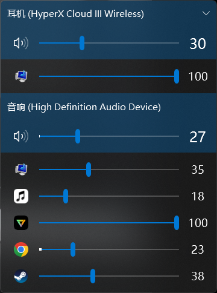

# EarTrumpet · 拖拽切换播放设备

按住某个应用，拖到另一个播放设备上松手 —— 声音就过去了。

这是 [File-New-Project/EarTrumpet](https://github.com/File-New-Project/EarTrumpet) 的修改版，基于官方 `master`（2.3.0，commit `42252bc`）。
除了拖拽本身，还按 Windows 11 Fluent 的规范补了一套拖拽反馈。



---

## 为什么做这个

Windows 自带的音量合成器要换应用的输出设备，路径是：右键应用 → 点双箭头 → 再选设备。

EarTrumpet 官方仓库里这个需求被提了七年 —— [Discussion #662](https://github.com/File-New-Project/EarTrumpet/discussions/662)（42 个 ❤️，标签 `feature: investigating`），
2022 年有人提交过实现（[PR #1122](https://github.com/File-New-Project/EarTrumpet/pull/1122)），但 2023 年 1 月被以「还需要设计工作」为由关闭，至今没有合并。

这个仓库把这件事做完了：一次拖拽完成切换，并且拖的时候能看清楚"现在会放到哪"。

## 功能

- **拖拽应用切换播放设备**：按住应用行拖到目标设备，松手生效
- **拖拽时的视觉反馈**
  - 跟随鼠标的卡片：应用图标 + 名称，8px 圆角、1px 描边、柔光投影
  - 目标设备高亮：强调色描边 + 9% 强调色填充
  - 其余设备淡化到 55%，明确区分"能放"和"不能放"
- **动效对齐 Win11 节奏**：`CubicEase` 减速、150–220ms、缩放 + 上浮入场
- 其余能力与上游 2.3.0 一致：应用级音量、峰值可视化、默认设备管理、亮/暗主题、20+ 语言

## 改动点

相对官方 `master`，一共动了 8 个文件（功能 6 个 + 构建适配 2 个）：

| 文件 | 改动 | 目的 |
| --- | --- | --- |
| `EarTrumpet/packages.config` | 新增 `gong-wpf-dragdrop 3.1.1` | 拖拽框架 |
| `EarTrumpet/EarTrumpet.csproj` | 引用 `GongSolutions.WPF.DragDrop`；`Windows` 引用加 `$(EarTrumpetWinMd)` 可选路径和 `<Private>False</Private>` | 引用库；让本机 SDK 10.0.26100 能编，且不把 7 MB 的 `Windows.winmd` 拷进输出 |
| `UI/ViewModels/DeviceViewModel.cs` | 实现 `IDropTarget`；新增 `IsDropTargetActive` / `IsDragInProgress` 与静态协调逻辑；`DragOver` 判定可放置性，`Drop` 调已有的 `MoveAppToDevice` | 拖拽的核心逻辑与状态 |
| `UI/ViewModels/FlyoutViewModel.cs` | 实现 `IDropTarget` 并转发给 `DeviceViewModel`，`DragLeave` 时清理状态 | 让面板根容器成为放置目标 |
| `UI/Views/DeviceView.xaml` | 应用列表设 `IsDragSource`；拖拽卡片模板；目标高亮覆盖层（`DataTrigger` 动画）；其余设备淡化的 `MultiDataTrigger` | 全部视觉反馈 |
| `UI/Views/FlyoutWindow.xaml` | 设备列表设 `IsDropTarget` + `DropHandler` | 接住 drop |
| `EarTrumpet/Properties/AssemblyInfo.cs` | 显式写 `AssemblyVersion` / `FileVersion` / `InformationalVersion` | 官方靠 CI 的 GitVersionTask 生成，本地编译没有 |
| `docs/changes.patch` | 完整补丁 | 方便 review |

放置判定是这样的：拖动源必须是应用，目标是设备（或该设备下的应用行），且目标不是它当前所在的设备 —— 否则光标显示禁止、不高亮。

## 编译

前置：Visual Studio 2022（含 .NET 桌面开发）、.NET Framework 4.6.2 Developer Pack、Windows SDK（提供 `UnionMetadata\...\Windows.winmd`）、NuGet。

```powershell
nuget restore EarTrumpet.vs15.sln

msbuild EarTrumpet\EarTrumpet.csproj `
  /t:Rebuild /p:Configuration=Release /p:Platform=x86 /p:Channel=AppInstaller `
  "/p:EarTrumpetWinMd=C:\Program Files (x86)\Windows Kits\10\UnionMetadata\10.0.26100.0\Windows.winmd" `
  /p:GetVersion=false /p:UpdateAssemblyInfo=false /p:GenerateGitVersionInformation=false /p:WriteVersionInfoToBuildLog=false `
  /p:GitVersion_MajorMinorPatch=2.3.0 /p:GitVersion_CommitsSinceVersionSource=0
```

产出是 `Build\Release\` 下的便携版目录，直接运行 `EarTrumpet.exe` 即可，不需要安装。

编译时踩到的两个坑（都写在 `docs/changes.patch` 之外的说明里）：

1. `al.exe` 生成语言资源时会报 `AL1032 拒绝访问` —— 把 `al.exe` 及其输出目录放到不含特殊 ACL 的路径下即可（本项目实测需要放在普通目录，而不是受保护的文档目录树下）。
2. 官方 csproj 只认 `Windows Kits\10\UnionMetadata\Windows.winmd` 和 `10.0.16299.0` 两个位置，新版 SDK 需要显式传 `EarTrumpetWinMd`。

## 已知限制

- 只支持 x86（上游工程本身如此）
- 没有 MSIX 安装包、没有代码签名、没有自动更新
- 拖拽只覆盖弹出面板里的视图，混音器窗口里也能拖，但视觉反馈按同一套样式
- 拖动后应用会**固定**在该设备上，界面上没有"恢复跟随默认设备"的入口 —— 这也是原 PR 被关闭时维护者提出的设计问题，本仓库没有改变这一点

## 项目来源

**这个项目不是我的原创，我只是给它加了一个功能。**

- **原创项目**：EarTrumpet，作者 **David Golden**（[@GoldenTao](https://github.com/GoldenTao)）、**Rafael Rivera**（[@riverar](https://github.com/riverar)）、**Dave Amenta**（[@davux](https://github.com/davux)），以及[所有贡献者](https://github.com/File-New-Project/EarTrumpet/graphs/contributors)。
  主页 <https://eartrumpet.app>，源码 <https://github.com/File-New-Project/EarTrumpet>，MIT 许可（含原项目自带的排除条款）。
- **本仓库做的事**：在上游 2.3.0 的基础上增加一个功能 —— 「拖拽应用切换播放设备」，以及配套的视觉反馈和构建适配。其余代码、图标、翻译、文档全部来自上游。
- **拖拽功能的初始思路**来自社区 PR [#1122](https://github.com/File-New-Project/EarTrumpet/pull/1122)（Masurov，2022 年提交、2023 年被官方关闭）。本仓库按该思路在 2.3.0 源码上重写，并补上了原 PR 没有的视觉反馈、状态管理和构建适配。
- **本仓库改动的文件**：8 个（7 个上游文件 + 1 份补丁），见上面的改动表。

引用或再分发时，请保留 `LICENSE` 与这段来源说明。

## 许可

MIT，随上游；见 [LICENSE](LICENSE)。

---

## English

A modified build of [EarTrumpet](https://github.com/File-New-Project/EarTrumpet) that lets you **drag an app row onto another playback device** to move its audio there, with Fluent-style drag feedback (follower card, accent-highlighted drop target, dimmed non-targets).

Based on upstream `master` (2.3.0, `42252bc`). Eight files changed: the drag-and-drop wiring, the visual layer, and two build adaptations. The idea originates from community PR #1122 (closed unmerged); this implementation is rewritten against 2.3.0 and adds the visuals and state handling.

**Original project**: EarTrumpet by David Golden, Rafael Rivera, Dave Amenta and contributors — <https://github.com/File-New-Project/EarTrumpet>. This fork only adds one feature on top of it; all other code, icons, translations and docs come from upstream.

Requires Visual Studio 2022 + .NET Framework 4.6.2 Developer Pack + Windows SDK. Output is a portable x86 folder under `Build\Release\`.
